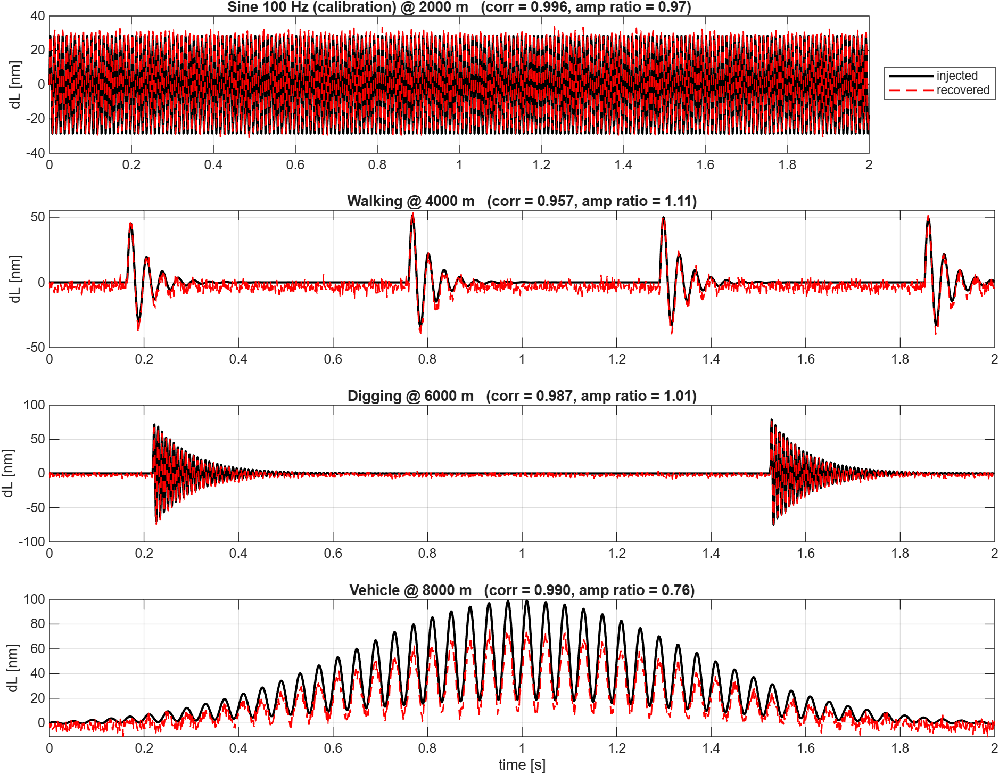
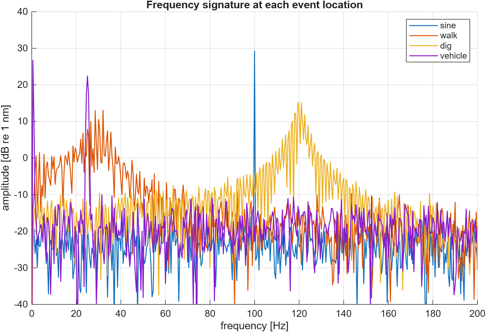
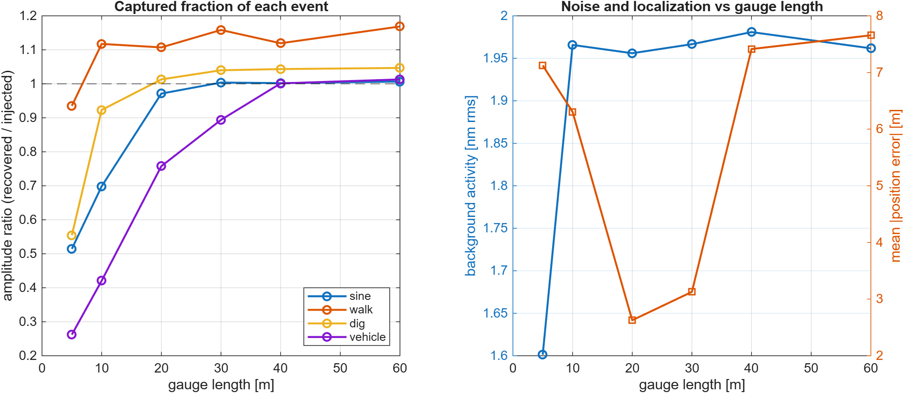
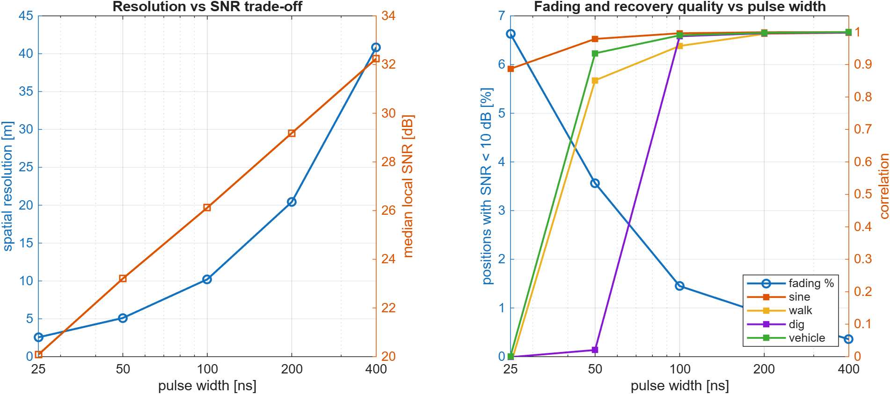

# DAS Simulation — Distributed Acoustic Sensing (φ-OTDR) in MATLAB

A physics-based simulator of a **Distributed Acoustic Sensing (DAS)** system built on
phase-sensitive optical time-domain reflectometry (**φ-OTDR**). It models a standard
single-mode fiber as a random Rayleigh-scattering medium, launches laser pulses into it,
injects real-world vibration events (walking, digging, a passing vehicle), and then
recovers *where* each event happened, *what* it looks like and *how strong* it was
— exactly as a real DAS interrogator would.

The whole chain is modelled end to end:

```
fiber (Rayleigh scatterers) → pulse → backscatter trace → waterfall (many pulses)
      → vibration events → detector (direct / coherent + noise) → phase processing
      → localization, waveform recovery, spectra
```

<p align="center">
  
</p>

---

## Physics in short

| Stage | Model |
|---|---|
| **Fiber** | Discrete scatterers at random positions (5 per metre). Each has a complex reflection coefficient with Rayleigh-distributed amplitude and uniform phase, plus the round-trip phase `2βz`. This is the fiber's static "fingerprint". |
| **Pulse & trace** | Round-trip attenuation `e^{-αz}`, then a causal convolution with the pulse: the detector sees the **coherent sum** of every scatterer inside the pulse → speckle (exponential power statistics). Spatial resolution `Δz = v_g·τ/2`. |
| **Events** | A vibration stretches a short fiber section by `ΔL(t)`. Light crossing it gains `φ(t) = k_strain·ΔL(t)`, with `k_strain = 4πnξ/λ` (ξ = photo-elastic factor). Only the phase changes, not the scatterer amplitudes. |
| **Detector** | *Direct*: `Y = |E|² + n` (power only). *Coherent* (I/Q): `Y = E + n`. Noise is fixed by the SNR at the fiber start, so local SNR falls with distance and collapses at **fading** points. |
| **Processing** | 1) reference removal `Y·conj(Y₁)` → 2) **gauge-length differential** over `G` metres → 3) amplitude-weighted averaging over one pulse (fading points get ~no weight) → 4) `ΔL = angle(Z)/k_strain`. |

### Previous (old-device) default system

| Parameter | Value |
|---|---|
| Fiber length | 10 km, SMF-28, n = 1.468, 0.2 dB/km |
| Laser | 1550 nm, 100 mW peak |
| Pulse width | 100 ns → **10.2 m** spatial resolution |
| PRF | 1 kHz → vibrations up to **500 Hz** |
| ADC | 100 MS/s |
| Detector SNR at fiber start | 30 dB |
| Gauge length | 20 m |
| Recording | 2 s (2000 pulses), fixed random seed (42) |

### Simulated events (`src/define_events.m`, positions = 0.2 / 0.4 / 0.6 / 0.8 of the fibre length; km below for 20 km)

| Event | Position | Signal |
|---|---|---|
| Sine (calibration) | 4 km | 100 Hz, 30 nm |
| Walking | 8 km | ~1.8 steps/s, damped 30 Hz rings |
| Digging | 12 km | strike every ~1.2 s, 120 Hz ring |
| Vehicle | 16 km | slow pass envelope + 25 Hz engine vibration |

---

## FEBUS A1-NEO parameters

Branch `febus-a1neo` simulates the **FEBUS A1-NEO** interrogator (FEBUS Optics datasheet, rev. 20260618).
All values live in one file, `src/das_params.m` (struct `p`); `src/params.m` only maps them to the legacy
`P.*` names used by the model. Every line carries a source tag, and `das_params` (no output) prints the
table *name | value | unit | final source*. Outputs go to `results_febus/` (old-device `results/` is untouched).

> **When vendor data arrives, edit only the FEBUS overrides block** (`p.tau_pulse_febus`, `p.dz_res_febus`,
> `p.f_s_febus`, `p.f_rep_febus`, `p.P0_febus`, `p.linewidth_febus`; `NaN` = not received yet).

Note: the datasheet's "acoustic sensing typically every 2 m" is the **channel spacing** (`dz_samp`), not the
spatial resolution (datasheet range 1–50 m; we choose `dz_res = 10 m`, as in Zeng 2024).

| Symbol | Value | Unit | Source |
|---|---|---|---|
| `lambda` | 1550e-9 | m | datasheet |
| `L_fiber_sim` | 20e3 | m | datasheet (20 km option) |
| `alpha_dB_km` | 0.2 | dB/km | datasheet |
| `dz_samp` | 2 | m | datasheet (channel spacing) |
| `dz_res` | 10 | m | datasheet range 1–50 m; value assumed (Zeng 2024) |
| `P_DAS` | 170 | W | datasheet (not used by the simulation) |
| `n_g` | 1.4682 | – | assumed: Corning SMF-28 Ultra PI-1424 |
| `R_bs_dB` | −82 | dB | assumed: Corning PI-1424 (1 ns pulse, 1550 nm) |
| `P0` | 0.1 | W | assumed: Thevenaz 2025; MI limit, Liu 2016 |
| `linewidth` | 3e3 | Hz | assumed: Zeng 2024; Juarez 2005 (documented, not used by the scatterer model) |
| `detection` | coherent | – | assumed: Zeng 2024 |
| `P_noise_ref`, `B_ref` | 0.2e-9, 100e6 | W, Hz | assumed: Thevenaz 2025 |
| `tau_pulse` | 97.9e-9 | s | derived |
| `f_s` | 51.05e6 | Hz | derived |
| `T_rt` | 195.9e-6 | s | derived |
| `f_rep_max` | 5.1e3 | Hz | derived |
| `f_rep` | 4.59e3 | Hz | derived (0.9 `f_rep_max`) |
| `f_vib_max` | 2.3e3 | Hz | derived (Nyquist, Wang 2020) |
| `P_noise` | 0.020e-9 | W | derived (∝ bandwidth, Palmieri 2013) |
| `Npulses` | 9188 | – | derived (≈ 2 s recording) |

Other tags: `xi` (0.78) is assumed from He & Liu 2021 (strain-optic coefficient K_ε ≈ 0.78 for standard SMF);
`scat_per_m` (5 /m), `os` (4), `seed` (42) and `pulse_shape` ('rect') are `[SIM SETTING]` (numerical modelling
choices, not device/fibre properties); `gauge` (20 m) is `[CHOSEN: FEBUS supports gauge >= 1 m; 20 m selected by gauge study (fig 07); Wang 2020 — short gauge lowers SNR, long gauge distorts signal]`.
Setting `gauge = dz_res` was tested and is clearly worse (at 10 m the amplitude ratios drop to 0.4–0.8 and
the 5 m case loses three of the four events), so the 20 m gauge is kept.
The capture fraction `S` is no longer a guess: it is derived from `R_bs_dB` (only the product `S·α_s` enters the
model, and it is fixed by the Corning coefficient, so the former separate Rayleigh-loss value is not needed).

Equations (`n_g` group index, `c` speed of light):

```
tau_pulse = 2 n_g dz_res / c                       (≈ 98 ns; dz_res = c tau / (2 n_g), Liu 2016)
f_s       = c / (2 n_g dz_samp)                    (≈ 51 MHz, ~5 samples per pulse)
f_rep_max = 1 / T_rt = c / (2 n_g L)               (≈ 5.1 kHz);  f_rep = 0.9 f_rep_max
B_rx      = 1 / tau_pulse
P_noise   = P_noise_ref (B_rx / B_ref)             (noise ∝ bandwidth, Palmieri 2013)
P_bs(z)   = P0 10^((R_bs_dB + 10 log10(tau_pulse / 1 ns))/10) 10^(-2 alpha_dB_km z / 1e4)    (z in m)
SNR(z)    = P_bs(z) / P_noise
```

Expected at the default settings: P_bs = 61.8 / 24.6 / 9.8 nW and SNR = 34.8 / 30.8 / 26.8 dB at 0 / 10 / 20 km.

### Model limitations

The simulator is a **theory / system-design tool**, not a digital twin of the FEBUS A1-NEO. It does NOT model:

- **Laser phase noise / finite linewidth:** `linewidth` is carried in `das_params` but unused; fibre scatterers are
  deterministic and the source is perfectly coherent over the fibre.
- **Polarisation:** a single polarisation state; no polarisation fading or birefringence.
- **Modulation instability and other nonlinear effects** (the 0.1 W peak power is taken from the literature, not checked).
- **Real interrogator internals:** the actual pulse shape/extinction ratio, amplifier (EDFA) noise and ASE, photodetector
  and ADC characteristics, local-oscillator frequency drift, and FEBUS's own signal processing (the noise floor is a
  single bandwidth-scaled number, `P_noise`).
- **Frequency drift / temperature** of the laser and fibre, and slow environmental drift of the Rayleigh fingerprint.
- **Fibre imperfections:** splices, connectors, bends, reflective events and distributed loss variations (uniform 0.2 dB/km only).
- **Realistic strain transfer:** cable coupling to the ground, anisotropic gauge response (broadside sensitivity) and
  dispersion; the fibre section is stretched uniformly, ΔL → phase via a constant factor `xi`.
- **Multiple channels / multiplexing** (one 20 km channel only) and **power consumption** (`P_DAS` is carried, not used).
- **Fading mitigation beyond the simple amplitude-weighted averaging** (no frequency-diversity or multimode combining).
- **Real vibration spectra:** events are synthetic (sine, walking, digging, vehicle), not field recordings.

### Sources

1. FEBUS A1-NEO datasheet, rev. 20260618.
2. Corning SMF-28 Ultra (G.652.D) datasheet PI-1424.
3. Thevenaz 2025.
4. Liu 2016.
5. Zeng 2024.
6. Juarez 2005.
7. Palmieri 2013.
8. Wang 2020.
9. He & Liu 2021 (strain-optic coefficient).

## Results (old-device default run, folder `results/`; FEBUS run is in `results_febus/`)

| Event | Position error | Amplitude ratio | Correlation with truth |
|---|---|---|---|
| Sine 100 Hz (calibration) | 4.2 m | 0.97 | 0.996 |
| Walking | 0.4 m | 1.11 | 0.957 |
| Digging | 1.8 m | 1.01 | 0.987 |
| Vehicle | 4.1 m | 0.76 | 0.990 |

- Calibration sine recovered at **100.0 Hz, 29.0 nm** (injected 100 Hz, 30 nm).
- Backscatter model matches theory: mean P/P_theory = 0.978, speckle std/mean = 1.064 (theory 1).
- Median local SNR 26.1 dB; only 1.5 % of positions fall below 10 dB (fading).
- Background noise floor ≈ 1.96 nm rms.

Full numbers: [`results/summary.txt`](results/summary.txt).

| | |
|---|---|
|  |  |
|  |  |

### Parameter studies (`analysis.m`)

Four design trade-offs are swept, each against the same events:

1. **Gauge length** (5–60 m): short gauges under-capture events longer than the gauge (vehicle amplitude ratio 0.26 at 5 m → 1.00 at 40 m), at the cost of coarser localization.
2. **Pulse width** (25–400 ns): resolution vs. SNR — at 25 ns fading reaches 6.6 % of positions and walking/digging are lost; longer pulses lower the noise floor (7.1 → 0.5 nm).
3. **Detector SNR** (5–40 dB): walking and digging need ≳ 25 dB; below 15 dB nothing is recovered.
4. **Fiber length** (5–30 km): at the far end of a 30 km fiber fading rises to 13 % and the walking event is lost.

| | |
|---|---|
|  |  |
|  |  |

Full tables: [`results/analysis_summary.txt`](results/analysis_summary.txt).

An animation of the sensing principle is in [`results/das_animation.mp4`](results/das_animation.mp4).

---

## Repository structure

```
DAS-Simulation/
├── main.m                 # full simulation: simulate → detect → process → figures + summary
├── analysis.m             # parameter studies (gauge, pulse width, SNR, fiber length)
├── das_app.m              # interactive GUI: 3D fiber view, live equations, results
├── animate_das.m          # 3D animation of the φ-OTDR principle (saves video)
├── waterfall_compare.m    # baseline (no events) vs event waterfalls
├── src/                   # the physical model
│   ├── params.m             # all system parameters + derived quantities
│   ├── fiber_model.m        # random Rayleigh scatterer fingerprint
│   ├── pulse.m              # probe pulse shape (rect / gauss)
│   ├── simulate_trace.m     # one backscatter trace
│   ├── define_events.m      # vibration scenario (sine, walking, digging, vehicle)
│   ├── apply_event.m        # applies event phase to the fiber at pulse m
│   ├── simulate_waterfall.m # all pulses → complex waterfall E(z, t)
│   ├── detector.m           # direct / coherent detection with noise
│   └── process_das.m        # phase demodulation → ΔL(z, t)
├── tests/                 # step-by-step physical checks of each block
│   ├── test_fiber.m  test_trace.m  test_event.m
│   └── test_waterfall.m  test_detector.m  test_process.m
└── results/               # figures, summaries and .mat outputs of the default run
```

---

## How to run

Requirements: **MATLAB R2022a or newer** (uses `clim`, `uigridlayout`, `exportgraphics`).
No extra toolboxes are needed.

Open MATLAB in the repository folder, then:

```matlab
main                % full simulation → results/01..06 + summary.txt
analysis            % parameter studies → results/07..10 + analysis_summary.txt
das_app             % interactive simulator
animate_das         % 3D animation (saves results/das_animation.mp4)
waterfall_compare   % baseline vs events comparison
```

Each script adds `src/` to the MATLAB path automatically. The tests can be run the same way,
e.g. `run tests/test_process.m`.

To change the system, edit only the **INPUT** sections of `src/params.m`
(derived values are recomputed automatically). To change the scenario, edit
`src/define_events.m`. Single parameters can also be overridden in code:

```matlab
P = params(struct('tau', 50e-9, 'gauge', 10));
```

> Memory: the default waterfall needs well under 2 GB. `params.m` warns if a
> configuration exceeds that — reduce `Npulses` or `L` if it does.

---

## Context

Developed as part of a capstone project on **distributed optical fiber sensing for perimeter
security** — Electrical Engineering (Telecommunications), Princess Nourah bint Abdulrahman University.

**Author:** Aljoud Almousa
**Author:** Yomna Almalki 
