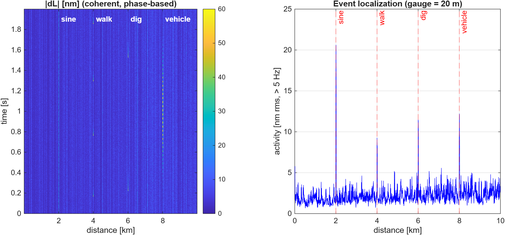
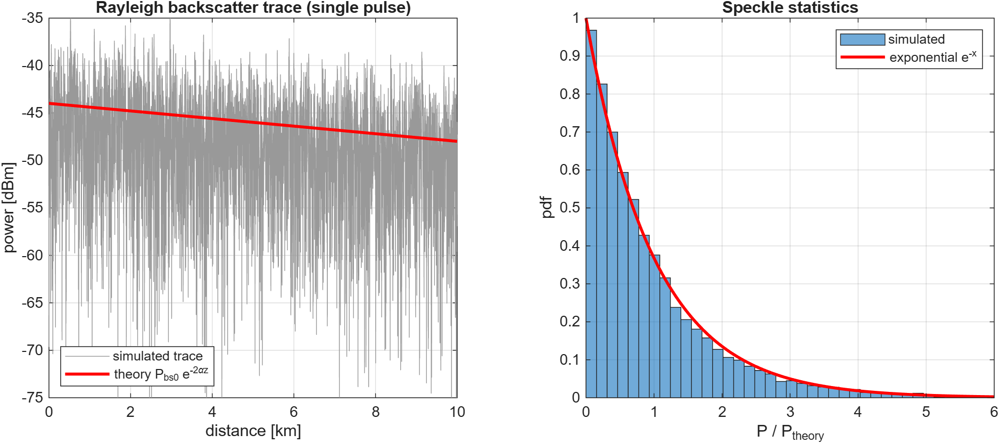
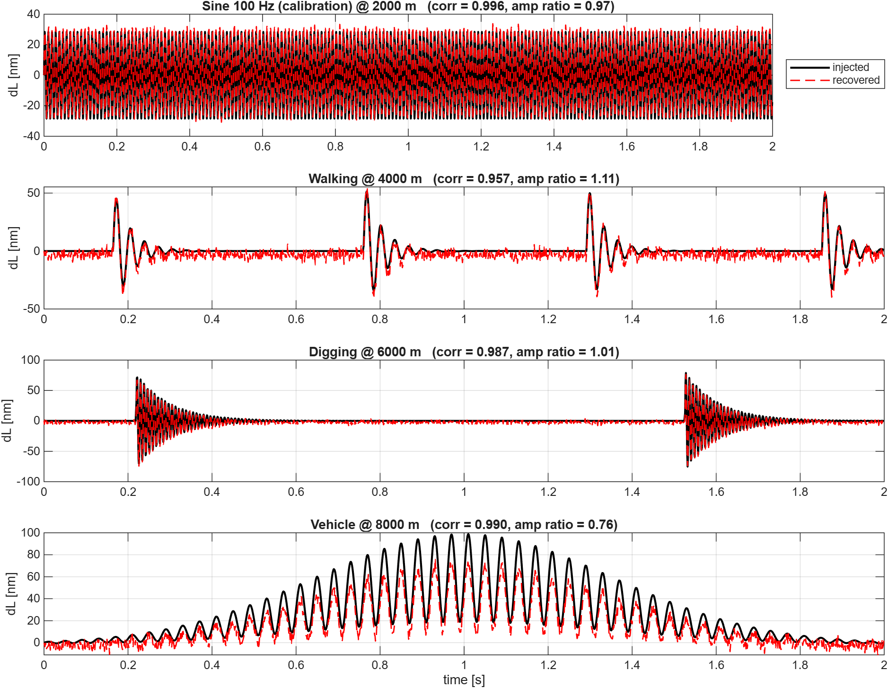
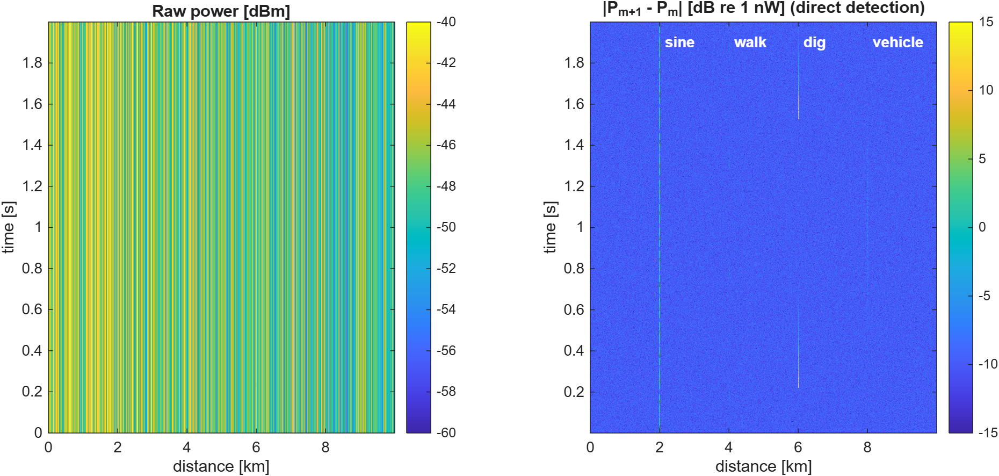
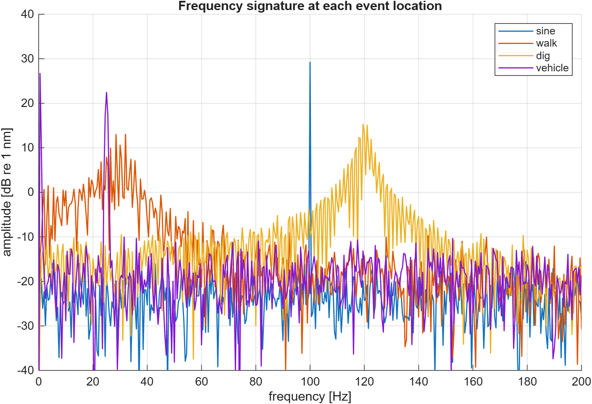
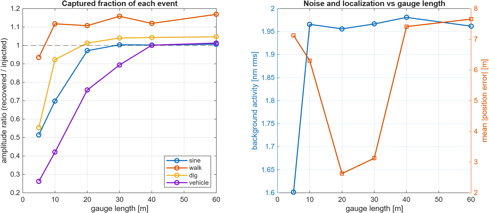
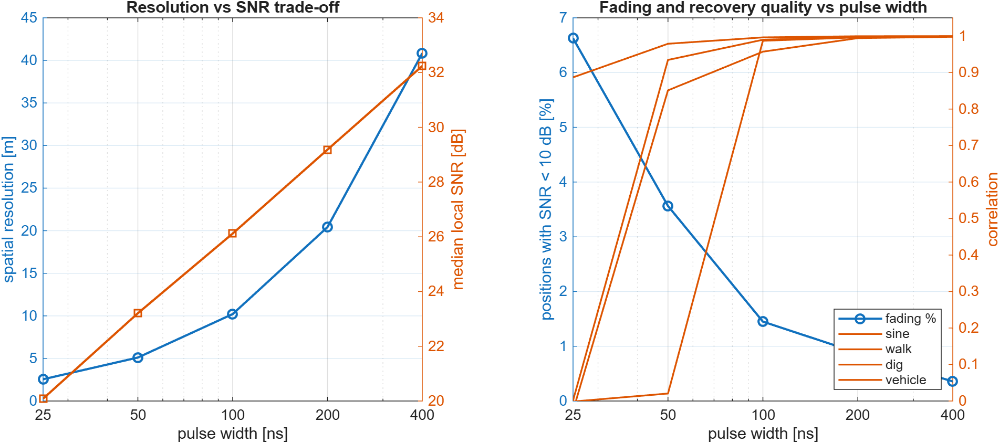
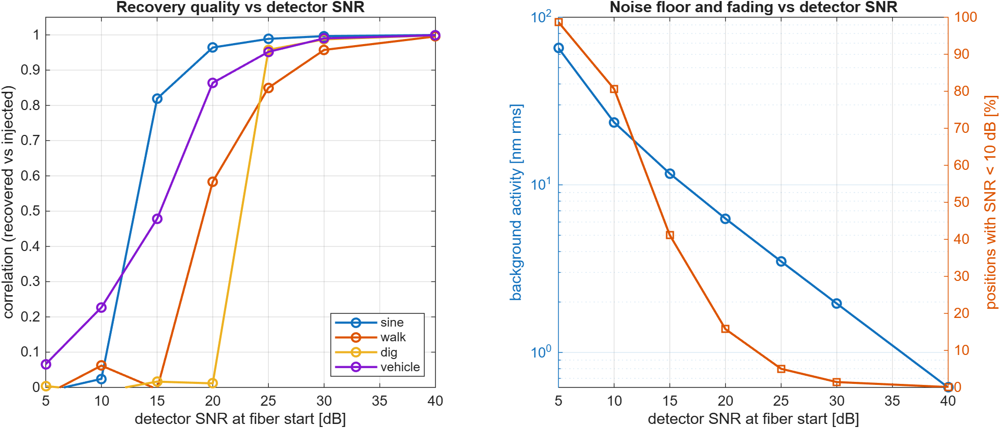
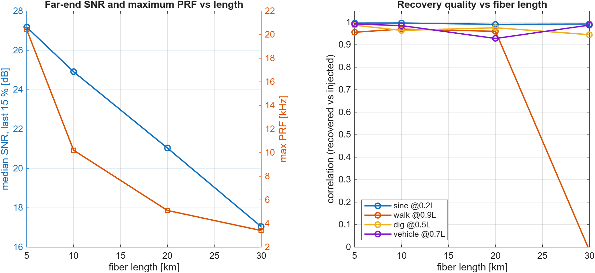

# DAS Simulation — Distributed Acoustic Sensing (φ-OTDR) in MATLAB

A physics-based simulator of a **Distributed Acoustic Sensing (DAS)** system built on
phase-sensitive optical time-domain reflectometry (**φ-OTDR**). It models a standard
single-mode fiber as a random Rayleigh-scattering medium, launches laser pulses into it,
injects real-world vibration events (walking, digging, a passing vehicle), and then
recovers *where* each event happened, *what* it looks like and *how strong* it was
— exactly as a real DAS interrogator would.

The whole chain is modelled end to end:

```
fiber (Rayleigh scatterers) → pulse → backscatter trace → waterfall (many pulses)
      → vibration events → detector (direct / coherent + noise) → phase processing
      → localization, waveform recovery, spectra
```

<p align="center">
  
</p>

---

## Physics in short

| Stage | Model |
|---|---|
| **Fiber** | Discrete scatterers at random positions (5 per metre). Each has a complex reflection coefficient with Rayleigh-distributed amplitude and uniform phase, plus the round-trip phase `2βz`. This is the fiber's static "fingerprint". |
| **Pulse & trace** | Round-trip attenuation `e^{-αz}`, then a causal convolution with the pulse: the detector sees the **coherent sum** of every scatterer inside the pulse → speckle (exponential power statistics). Spatial resolution `Δz = v_g·τ/2`. |
| **Events** | A vibration stretches a short fiber section by `ΔL(t)`. Light crossing it gains `φ(t) = k_strain·ΔL(t)`, with `k_strain = 4πnξ/λ` (ξ = photo-elastic factor). Only the phase changes, not the scatterer amplitudes. |
| **Detector** | *Direct*: `Y = |E|² + n` (power only). *Coherent* (I/Q): `Y = E + n`. Noise is fixed by the SNR at the fiber start, so local SNR falls with distance and collapses at **fading** points. |
| **Processing** | 1) reference removal `Y·conj(Y₁)` → 2) **gauge-length differential** over `G` metres → 3) amplitude-weighted averaging over one pulse (fading points get ~no weight) → 4) `ΔL = angle(Z)/k_strain`. |

### Default system (`src/params.m`)

| Parameter | Value |
|---|---|
| Fiber length | 10 km, SMF-28, n = 1.468, 0.2 dB/km |
| Laser | 1550 nm, 100 mW peak |
| Pulse width | 100 ns → **10.2 m** spatial resolution |
| PRF | 1 kHz → vibrations up to **500 Hz** |
| ADC | 100 MS/s |
| Detector SNR at fiber start | 30 dB |
| Gauge length | 20 m |
| Recording | 2 s (2000 pulses), fixed random seed (42) |

### Simulated events (`src/define_events.m`)

| Event | Position | Signal |
|---|---|---|
| Sine (calibration) | 2 km | 100 Hz, 30 nm |
| Walking | 4 km | ~1.8 steps/s, damped 30 Hz rings |
| Digging | 6 km | strike every ~1.2 s, 120 Hz ring |
| Vehicle | 8 km | slow pass envelope + 25 Hz engine vibration |

---

## Results (default run)

| Event | Position error | Amplitude ratio | Correlation with truth |
|---|---|---|---|
| Sine 100 Hz (calibration) | 4.2 m | 0.97 | 0.996 |
| Walking | 0.4 m | 1.11 | 0.957 |
| Digging | 1.8 m | 1.01 | 0.987 |
| Vehicle | 4.1 m | 0.76 | 0.990 |

- Calibration sine recovered at **100.0 Hz, 29.0 nm** (injected 100 Hz, 30 nm).
- Backscatter model matches theory: mean P/P_theory = 0.978, speckle std/mean = 1.064 (theory 1).
- Median local SNR 26.1 dB; only 1.5 % of positions fall below 10 dB (fading).
- Background noise floor ≈ 1.96 nm rms.

Full numbers: [`results/summary.txt`](results/summary.txt).

| | |
|---|---|
|  |  |
|  |  |

### Parameter studies (`analysis.m`)

Four design trade-offs are swept, each against the same events:

1. **Gauge length** (5–60 m): short gauges under-capture events longer than the gauge (vehicle amplitude ratio 0.26 at 5 m → 1.00 at 40 m), at the cost of coarser localization.
2. **Pulse width** (25–400 ns): resolution vs. SNR — at 25 ns fading reaches 6.6 % of positions and walking/digging are lost; longer pulses lower the noise floor (7.1 → 0.5 nm).
3. **Detector SNR** (5–40 dB): walking and digging need ≳ 25 dB; below 15 dB nothing is recovered.
4. **Fiber length** (5–30 km): at the far end of a 30 km fiber fading rises to 13 % and the walking event is lost.

| | |
|---|---|
|  |  |
|  |  |

Full tables: [`results/analysis_summary.txt`](results/analysis_summary.txt).

An animation of the sensing principle is in [`results/das_animation.mp4`](results/das_animation.mp4).

---

## Repository structure

```
DAS-Simulation/
├── main.m                 # full simulation: simulate → detect → process → figures + summary
├── analysis.m             # parameter studies (gauge, pulse width, SNR, fiber length)
├── das_app.m              # interactive GUI: 3D fiber view, live equations, results
├── animate_das.m          # 3D animation of the φ-OTDR principle (saves video)
├── waterfall_compare.m    # baseline (no events) vs event waterfalls
├── src/                   # the physical model
│   ├── params.m             # all system parameters + derived quantities
│   ├── fiber_model.m        # random Rayleigh scatterer fingerprint
│   ├── pulse.m              # probe pulse shape (rect / gauss)
│   ├── simulate_trace.m     # one backscatter trace
│   ├── define_events.m      # vibration scenario (sine, walking, digging, vehicle)
│   ├── apply_event.m        # applies event phase to the fiber at pulse m
│   ├── simulate_waterfall.m # all pulses → complex waterfall E(z, t)
│   ├── detector.m           # direct / coherent detection with noise
│   └── process_das.m        # phase demodulation → ΔL(z, t)
├── tests/                 # step-by-step physical checks of each block
│   ├── test_fiber.m  test_trace.m  test_event.m
│   └── test_waterfall.m  test_detector.m  test_process.m
└── results/               # figures, summaries and .mat outputs of the default run
```

---

## How to run

Requirements: **MATLAB R2022a or newer** (uses `clim`, `uigridlayout`, `exportgraphics`).
No extra toolboxes are needed.

Open MATLAB in the repository folder, then:

```matlab
main                % full simulation → results/01..06 + summary.txt
analysis            % parameter studies → results/07..10 + analysis_summary.txt
das_app             % interactive simulator
animate_das         % 3D animation (saves results/das_animation.mp4)
waterfall_compare   % baseline vs events comparison
```

Each script adds `src/` to the MATLAB path automatically. The tests can be run the same way,
e.g. `run tests/test_process.m`.

To change the system, edit only the **INPUT** sections of `src/params.m`
(derived values are recomputed automatically). To change the scenario, edit
`src/define_events.m`. Single parameters can also be overridden in code:

```matlab
P = params(struct('tau', 50e-9, 'gauge', 10));
```

> Memory: the default waterfall needs well under 2 GB. `params.m` warns if a
> configuration exceeds that — reduce `Npulses` or `L` if it does.

---

## Context

Developed as part of a capstone project on **distributed optical fiber sensing for perimeter
security** — Electrical Engineering (Telecommunications), Princess Nourah bint Abdulrahman University.

**Author:** Aljoud Almousa
